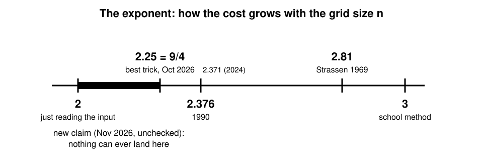

# How fast can you multiply two grids of numbers?

*A story for anyone who knows how to multiply. Written 26 November 2026. The last part reports a claim that is two days old and has not been checked by other mathematicians.*

## The school method

A *grid* (mathematicians say "matrix") is a square table of numbers with n rows and n columns. To multiply two grids you fill in a third one. The entry in row 3, column 5 of the answer is: take row 3 of the first grid and column 5 of the second, multiply them entry by entry, and add up the n products.

The answer has n × n entries and each one needs n multiplications, so the school method uses n × n × n = n³ multiplications. For a 1000 × 1000 grid that is a billion. Weather forecasts, video games, search engines and AI programs multiply big grids all day long, so people care a lot about that 3 in n³. It is called the **exponent**.

## Strassen's trick: 7 instead of 8

Cut each grid into four blocks:

The school method needs 8 block products (two for each of the four blocks of the answer). In 1969 Volker Strassen found a way to do it with 7. Here are his seven products:

- M1 = (a + d)·(e + h)
- M2 = (c + d)·e
- M3 = a·(f − h)
- M4 = d·(g − e)
- M5 = (a + b)·h
- M6 = (c − a)·(e + f)
- M7 = (b − d)·(g + h)

and the four blocks of the answer are M1 + M4 − M5 + M7, M3 + M5, M2 + M4, and M1 − M2 + M3 + M6. Check one yourself: M3 + M5 = a·f − a·h + a·h + b·h = a·f + b·h, which is the top right block. One multiplication has been traded for a handful of additions, and additions are cheap.

**Why a trick for size 2 helps at every size.** The letters a to h can be blocks, not just numbers, because the trick never swaps the order of a product. So a 1024 × 1024 grid is a 2 × 2 grid of 512 × 512 blocks, each of those is a 2 × 2 grid of 256 × 256 blocks, and so on ten times. The school method multiplies the work by 8 at each level; Strassen multiplies it by 7. Ten levels of 7 instead of 8 turns n³ into about n^2.81.

## How low can the exponent go?

After Strassen, people found cleverer and cleverer tricks. The exponent fell to 2.5 by 1981 and to 2.376 by 1990. Then it stalled: thirty-four more years of hard work moved it only to 2.371.

Nobody can go below 2, because the answer has n² entries and you must at least write them down. For decades most experts guessed that the true answer is exactly 2: that with enough cleverness, multiplying grids costs barely more than reading them. No one could find any reason for a barrier above 2.

In October 2026 a new trick, based on multiplying polynomials, reached **2.25, which is 9/4**. Several groups have checked and re-proved it. Then on 24 November 2026 came a much bolder claim: **9/4 is the end of the road. No trick, however clever, will ever beat it.**

## Where does the number 9/4 come from? A game with six friends

Here is the cleanest way I know to see the number. It explains why the best trick lands on 9/4, and what the new claim says.

Six friends want to set up shared secrets: every pair of friends should end up with its own secret coin flip. That is 15 coins. They are allowed one tool: a loudspeaker that announces a single random number to all six at once. From that number each friend computes, alone, what they need. How many bits must the announced number have?

Split the six into two groups of three. Nine pairs straddle the split, so nine coins' worth of randomness has to cross from one side to the other, and the only thing both sides hear is the loudspeaker. So you need **at least 9 bits**. Surprisingly, 9 bits are also enough (in the long run, when the game is repeated many times). That is what the polynomial trick achieves.

Now put the friends into three teams of two, and let team-mates sit together and pool what they know. This team game *is* grid multiplication. The three teams are the first grid, the second grid and the answer; for 16 × 16 grids each pair of teams must agree on a label with 16 values, which is 4 coins; and a method using R multiplications is a loudspeaker with R possible announcements.

Teaming up can only make things easier, so 9 bits still suffice. Could fewer do? Run the splitting argument again, but now a split is not allowed to break up a team. The best split has one team against two, and only **8** coins cross it.

So the truth for the team game is somewhere between 8 and 9:

- **8** would mean exponent 8/4 = **2**. This was the old belief.
- **9** means exponent **9/4**. This is the new claim: sitting together does not help the teams at all.

The school method, by the way, corresponds to 12 bits (all the coins between different teams), and 12/4 = 3.

## Why would you not be able to reach 2?

Honestly: the number 9/4 comes from the best trick we know. The new claim is that the trick cannot be improved, and the reason given has nothing to do with coins or triangles. It goes like this.

**Step 1. A faster multiplier would be a bulk-discount machine.** The paper argues that if grids could be multiplied even slightly faster than n^(9/4), you could build fast sorting from it, and from fast sorting a general discount: take any small computation at all, and you could run a thousand copies of it for noticeably less than a thousand times the price. Then you could apply the discount to the discounted machine, and again, and again.

**Step 2. Some jobs cannot be discounted forever.** Take the job "here are several lists of numbers; does any list contain a repeat?". Checking this is as hard as running a parcel service: every record must be able to reach any position, to be compared with whatever sits there. A parcel network with too few roads cannot deliver every parcel to every possible address, because the total distance the parcels may have to travel is more than the total length of road. So this job has a price floor per record that no amount of batching removes.

Repeated discounts from Step 1 would go through that floor. So Step 1's assumption must be false: nothing beats n^(9/4).

That is the whole shape of the argument. The details fill about a hundred pages.

> **What we don't know, and why experts will be cautious**
>
> - The "no trick can beat 9/4" claim is two days old. Nobody outside the authors has checked it. Only the 9/4 *trick* itself is confirmed.
> - It would overturn a famous thirty-year-old conjecture of Strassen, which predicted exponent 2.
> - The proof leans on two other brand-new, unchecked papers. And its Step 2, taken alone, would already settle a different famous open problem (it shows that a simple yes-or-no task needs more than a fixed number of operations per input bit). When one proof quietly solves two famous problems, careful people look twice.
> - The explanation of the *number* is solid: it is a count of coins crossing a split. The explanation of why you *cannot do better* is only as good as that hundred-page proof.
> - For small grids none of this changes anything. For 2 × 2 grids Strassen's 7 is still the best possible.

## The same story in six tweets

> 1/ Multiplying two n×n grids of numbers the school way takes n³ multiplications. In 1969 Strassen showed 2×2 blocks need only 7 products, not 8. Use it inside every block, again and again, and n³ becomes n^2.81.

> 2/ For 55 years people pushed that exponent down: 2.81, 2.5, 2.376, 2.371. It can't go below 2, since you must write n² answers. Most experts guessed the truth is exactly 2.

> 3/ October 2026: a new trick reaches 2.25 = 9/4, now confirmed by several groups. 24 November 2026: a claim that 9/4 is the true answer, so no trick will ever do better. That part is unchecked.

> 4/ Why 9/4? Six friends, a secret coin for each pair, one loudspeaker. Split them 3 against 3: nine pairs straddle the split, so the announcement needs 9 bits. Nine turns out to be enough.

> 5/ Seat the friends in 3 teams of 2 and you have 16×16 grid multiplication, with 4 coins per pair of teams. Splits that keep teams together cut only 8 coins. Exponent 2 means 8/4. The claim is that it stays 9: 9/4.

> 6/ Why no better? A faster multiplier would give a bulk discount on all computation, and repeated discounts would let you check lists for duplicates cheaper than parcel-routing allows. If the 100-page proof holds, a famous conjecture falls.
