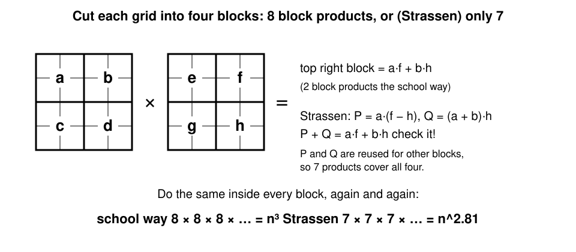
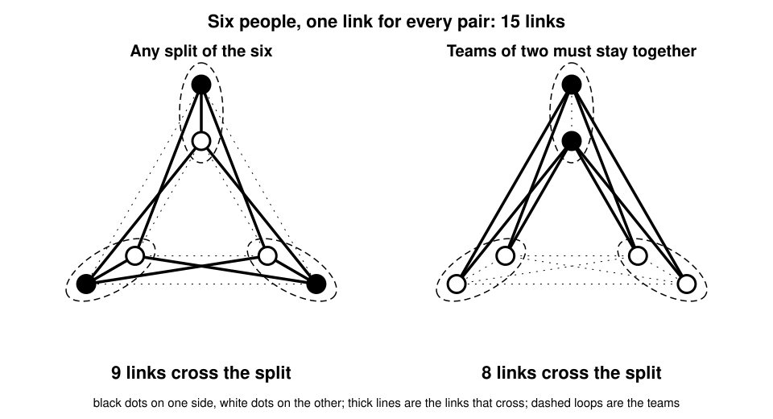

# How fast can you multiply two grids of numbers?

*A story for anyone who knows how to multiply. Written 26 November 2026. The last part reports a claim that is two days old and has not been checked by other mathematicians.*

## The school method, and Strassen's trick

A *grid* (a "matrix") is a square table of numbers with n rows and n columns. To multiply two grids you fill in a third. Its entry in row 3, column 5 is: take row 3 of the first grid and column 5 of the second, multiply them entry by entry, and add. That is n multiplications for each of n × n entries, so **n³** in all. The 3 is called the **exponent**. Computers multiply huge grids all day, so the exponent matters.

Cut each grid into four blocks:

The school method needs 8 block products. In 1969 Volker Strassen did it with 7:

- M1 = (a + d)·(e + h)  M2 = (c + d)·e  M3 = a·(f − h)  M4 = d·(g − e)
- M5 = (a + b)·h  M6 = (c − a)·(e + f)  M7 = (b − d)·(g + h)

The four blocks of the answer are M1 + M4 − M5 + M7, M3 + M5, M2 + M4 and M1 − M2 + M3 + M6. Check one: M3 + M5 = a·f − a·h + a·h + b·h = a·f + b·h, the top right block.

The letters can themselves be blocks, because the trick never swaps the order of a product. So a 1024 × 1024 grid is a 2 × 2 grid of 512 × 512 blocks, each of which is a 2 × 2 grid of smaller blocks, ten levels deep. The school method multiplies the work by 8 per level, Strassen by 7. That turns n³ into about n^2.81.

## How low can the exponent go?

Cleverer tricks brought the exponent to 2.376 by 1990, and then only to 2.371 in the next thirty-four years. It cannot go below 2, since the answer has n² entries that must at least be written down. Most experts guessed the truth is exactly 2.

In October 2026 a new trick reached **2.25 = 9/4**, and several groups have confirmed it. On 24 November 2026 came a bolder claim: **9/4 is the final answer. No trick will ever beat it.**

## Where 9 and 4 come from: a game of matching switches

Three people, A, B and C. Every pair is joined by a *link*, and each person has an on/off switch at their end of each link. So each person holds two switches. Call a setting of all six switches **consistent** if on every link the two ends match. Write down the table that gives 1 to consistent settings and 0 to the others.

We want to build this table out of **simple pieces**. In a simple piece A, B and C each write, on their own, a list of numbers, one for each way of setting their own switches. The piece's value at a setting is A's number times B's number times C's number. Pieces may be added and subtracted, so they can cancel each other.

*How many simple pieces does the consistency table need?*

This is 2 × 2 grid multiplication in disguise: A is the first grid, B the second, C the answer, and one piece is one multiplication. The school method uses 8 pieces. Strassen's seven products are 7 pieces.

There is also a floor. Put A on one side and B, C on the other. Two links cross, so A's two switches must be matched across the split: four possibilities. Seen across a split, one simple piece can only say "my side's number times your side's number", and it takes at least four of those to build a four-way match. So at least 4 pieces: that is the n² floor.

**Now six people**, every pair linked: 15 links.

Split them three against three (left picture). Nine links cross. Matching nine switches across a split has 2⁹ possibilities, so the table needs at least 2⁹ pieces. Call that **cost 9**. The polynomial trick of 2026 shows that cost 9 can actually be met: the three-against-three split is the true bottleneck. (Precisely: playing N rounds at once needs about 2^(9N) pieces.) For six separate people the answer is exactly 9. The floor is elementary; that it can be met is a theorem from autumn 2026.

**Now let them sit in three teams of two** (right picture). A team writes one joint list, so more tables count as "simple" and the job can only get easier. Links inside a team no longer matter. Between two teams there are 4 links, which is a label with 16 values, and the team game is exactly **16 × 16 grid multiplication**.

Cost 9 still works. Could it drop? Redo the floor argument, but a split may not cut a team in half. The best split is one team against two: only **8** links cross.

- Cost **8** would be exponent 8/4 = **2**, the old belief.
- Cost **9** is exponent **9/4**, the new claim: *teaming up never saves the ninth bit.*

(The school method is cost 12, all the links between different teams: 12/4 = 3.)

So the whole question fits in one sentence: **when neighbours team up, does the bottleneck of the un-teamed game still apply?**

Other team sizes give other shapes of grid. With teams of p, q and r people the cost is (p + q + r)²/4, half the people times the other half, as long as no team has more than half of them. If one team is bigger than all the rest together, the cost is (big team) × (rest), and then a team-respecting split already achieves it. That case is a tall thin grid times a short wide one, and there the cost really is just the size of the answer. Square grids are the balanced case, where the best split has to cut through teams.

> **What this picture hides**
> - "Cost 9" is about long runs: the number of pieces for N rounds grows like 2^(9N). For a single 2 × 2 multiplication the best is still 7, far above the floor of 4 and above the claimed long-run rate 2^(9/4) ≈ 4.76.
> - Pieces are added *and subtracted*. Cancellation is why 9 can be enough when there are 15 links. If you think of the links as secret coins and the pieces as public announcements, you will get the wrong answer (15).
> - How the trick meets the bottleneck is not shown. It uses multiplication of polynomials.

## Why would teaming never help?

Here there is no simple picture, and I will not pretend otherwise. The claimed proof is about a hundred pages and runs by contradiction. Its shape:

**Either** a certain mathematical "best position" shifts when you tweak a parameter, and then a direct calculation gives 9/4.

**Or** nothing ever shifts, and then a faster-than-9/4 multiplier becomes a **bulk-discount machine**: it gives fast sorting, and from that a way to run a thousand copies of *any* small computation for noticeably less than a thousand times the price, over and over.

But some jobs cannot be discounted forever. "Here are several lists; does any list contain a repeat?" is like a parcel service: each record must be able to reach any position. The total distance the records may need to travel cannot exceed the total length of wire in the machine. That sets a price floor per record, and repeated discounts would break through it.

> **Why experts will be cautious**
> - Only the trick (exponent at most 9/4) is confirmed. "Nothing beats 9/4" is two days old and unchecked.
> - It would overturn a famous conjecture of Strassen from the 1990s, which predicted exponent 2.
> - The price-floor step rests on two other new, unchecked papers, and taken alone it would settle another famous open problem about how many operations a simple yes/no task needs. One proof quietly solving two famous problems deserves a second look.
> - The number 9/4 enters the proof through the same family of tricks that gave the upper bound. I could not confirm that the match at 9/4 is more than that method agreeing with itself.

## Six tweets

> 1/ Multiplying two n×n grids the school way takes n³ multiplications. In 1969 Strassen showed that 2×2 blocks need only 7 products, not 8. Use that inside every block, again and again, and n³ becomes n^2.81.

> 2/ For 55 years the exponent crept down: 2.81, 2.5, 2.376, 2.371. It can't go below 2, because you must write down n² answers. Most experts guessed the truth is exactly 2.

> 3/ Oct 2026: a new trick reaches 2.25 = 9/4 (confirmed). 24 Nov 2026: a claim that 9/4 is the true answer and no trick will ever do better (unchecked).

> 4/ Where do 9 and 4 come from? Link six people in all 15 pairs and ask them to match switches on every link. Split them 3 against 3: nine links cross. That bottleneck, cost 9, is exactly what the job costs.

> 5/ Seat them in 3 teams of 2: that is 16×16 grid multiplication, 4 links per pair of teams. Splits that keep teams whole cut only 8 links. Exponent 2 means cost 8. The claim: teaming never saves the ninth bit. 9/4.

> 6/ Why not? The proof says a faster multiplier would give a bulk discount on all computation, enough to check lists for repeats more cheaply than moving the records allows. 100 pages, overturns a famous conjecture, not yet checked.
