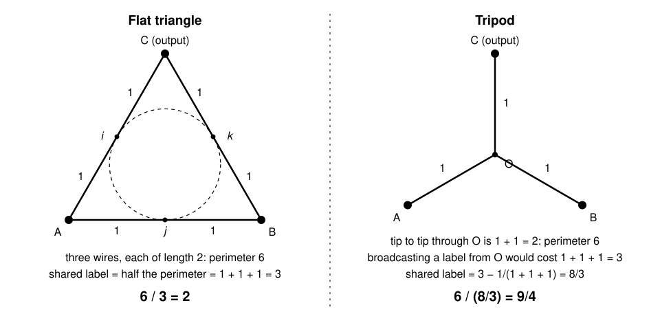

# Why would the matrix multiplication exponent be exactly 9/4?

26 Nov 2026. An explanation for a curious programmer or mathematician, with the status of every step marked.

## 0. Status, before anything else

- **ω ≤ 9/4** is the October result (OpenAI, 2 Oct 2026, over ℂ; extended to every field by Amanov–van den Berg–Zuiddam, arXiv:2610.30054, with other expositions by Pass, Lü, Li, Doğan–Lysikov–Sakabe–Walter). It has been re-derived by several independent groups. Everything in this note that explains *the number* 9/4 lives on this side.
- **ω ≥ 9/4** is a claim made two days ago (OpenAI, "The matrix multiplication exponent is nine fourths", 24 Nov 2026). It is unrefereed, about 100 pages, and rests on two companion papers of the same date. Its proof is by contradiction and gives no direct intuition for the number. I have read the parts quoted here; I have not verified it.
- Tags used below: **[paper]** = stated in the cited paper; **[check]** = I recomputed it (algebra or the small scripts described in §6); **[gloss]** = my own heuristic reading, not something the papers say.

## 1. The one-paragraph answer

Put the two input matrices and the output at three sites. Each of the three indices i, j, k of a matrix product is shared by exactly two sites, so the product is a triangle of three wires, and under any consistent "price list" for tensors its price is the perimeter of that triangle. An algorithm with r multiplications builds the same tensor from one label with r values that all three sites can see, so the exponent is at least the perimeter divided by the per-bit price of a three-way label. In flat (Euclidean) geometry a three-way label costs exactly half the perimeter, which gives the classical ω ≥ 2. Outside flat geometry the label can be cheaper than half the perimeter, but only by a bounded discount: if the three distances are written as a+b, b+c, c+a, the label costs at least (a+b+c) − 1/(1/a+1/b+1/c). The subtracted term is at most one ninth of a+b+c, with equality when a = b = c. So the perimeter-to-label ratio is at most 2/(1 − 1/9) = 9/4. That inequality is the algorithm. The new claim is that some price list attains it.

In one line: **9/4 = 2 × 9/8**, where 2 is the flat answer and 9/8 = 1/(1 − (1/3)²) is the largest discount three arms allow.

## 2. The picture

**Prices.** A *spectral point* (Strassen, 1988) is a number φ(T) ≥ 1 attached to every nonzero tensor on a fixed set of parties, such that φ multiplies under tensor product, adds under direct sum, cannot increase when each party applies a linear map, and φ(1) = 1. Flattening ranks are examples. A *price* is a logarithm of such a φ. Prices add when you put independent things side by side and never go up under local processing. [paper, §3]

**Distance.** A *wire* of size q between parties X and Y is the tensor Σ_{m≤q} e_m ⊗ e_m: X and Y share an index with q values and nobody else sees it. Its price is d(X,Y)·log q for a number d(X,Y), the price per bit of sharing between X and Y. Chaining wires gives the triangle inequality, so d is a (pseudo)metric on the parties. [paper, §3.1]

**Matrix multiplication is a triangle.** T_n = Σ e_ij ⊗ e_jk ⊗ e_ki. Party A holds (i,j), party B holds (j,k), party C holds (k,i). Index j is a wire of size n between A and B, k between B and C, i between C and A, and the three are independent. So

  price(T_n) = (d_AB + d_BC + d_CA)·log n = perimeter × log n. [paper, §1.3]

**A rank decomposition is one shared label.** T_n = Σ_{ℓ≤r} u_ℓ ⊗ v_ℓ ⊗ w_ℓ means: give all three parties the same label ℓ ∈ [r], then let each apply its own linear map. A label with r values shared by all three costs D·log r, where D is the *shared-label rate*. Prices cannot go up under local maps, so

  perimeter × log n ≤ D × log r,  that is  **r ≥ n^(perimeter/D)**. [paper, §1.3]

Strassen's duality theorem says this is not just a lower bound: ω equals the supremum of perimeter/D over all spectral points. So "what is ω?" is the same question as "how cheap can a three-way label be, relative to the triangle it spans?". [paper §11.3 uses this; our `research/next/x2/notebook.md` §1 has the dictionary]

**Arms.** Any three distances can be written as d_AB = a+b, d_BC = b+c, d_CA = c+a with a, b, c ≥ 0 (take a = (d_AB + d_CA − d_BC)/2, and so on). In a Euclidean triangle these are the tangent lengths of the incircle. In a tree they are the arms of the tripod joining the three points. Half the perimeter is a+b+c in both cases.

## 3. Flat geometry gives exactly 2

The simplest spectral points are matrix ranks across a cut of the parties. Across a cut that separates the three parties, the label has rank r (price 1 per bit) and exactly two of the three wires are cut (price 2 per bit in total). The ratio is 2 for every such cut, and it stays 2 under any averaging of cuts. This is the flattening bound R(T_n) ≥ n², i.e. ω ≥ 2.

The Euclidean companion paper makes this a theorem about geometry: one can price tensors so that a wire between two sites of a Hilbert space costs their Euclidean distance, and then a label shared among several sites is *forced* to cost the mean width of their convex hull, which for three sites is half the perimeter of the triangle. [paper: "Euclidean geometry in the asymptotic spectrum of tensors", Thm 1.1 and Thm 5.3] So every flat price gives perimeter/D = 2 exactly. To see ω > 2 at all, one needs three sites that do not sit together in any flat.

Our own notes reached the same wall from the other direction: prices obtained from routing through hubs, cuts and Euclidean configurations only ever certify ω ≥ 2 (`research/next/x2/notebook.md` §2, `research/vpvnp/b2`, `research/vpvnp/c1`).

## 4. The tripod, and what the two naive answers would mean

Take three rays leaving a common point O and put the parties at distance 1 from O, one on each ray. Tip-to-tip distance is 1 + 1 = 2 and the perimeter is 6. What is D?

- **D ≤ 3.** Create the label at O and copy it along each arm. This is the sum of the arms. [paper, (11.1)]
- **D ≥ 2.** Forgetting one party turns the label into a wire between the other two, which costs 2.

The two ends of this interval are exactly the two classical candidate answers:

| label rate D on the unit tripod | meaning | exponent 6/D |
|---|---|---|
| 3 | a label is no cheaper than broadcasting it from the hub | 2 |
| 8/3 | claimed truth | 9/4 |
| 2 | a three-way label costs no more than a single wire | 3 |

So "ω = 2" is the statement that a three-way label is never cheaper than half the perimeter of the triangle it spans, and "ω = 9/4" is the statement that it can be cheaper by one ninth and no more.

## 5. Where 8/3 comes from

### 5.1 Two lines

The tensor that does the work is **polynomial multiplication**: C(a,b) = Σ x_i y_j z_{i+j}, the product of a polynomial with a coefficients and one with b coefficients. Two facts about it, on the unit tripod with the two inputs and the output at the three tips:

1. **Scaling costs exactly the label rate.** If you multiply both lengths by λ, the price goes up by D·log λ. Reason: cutting the degree range into λ intervals exhibits λ disjoint copies of the smaller multiplication inside the larger one, and λ disjoint copies of anything cost one extra label with λ values; conversely evaluation at a+b points computes C(a,b) from a label with a+b values (the label *is* the evaluation point), so the price cannot grow faster. [paper, Lemma 9.1] Hence, with P(x,y) the price at lengths x, y:  x·∂P/∂x + y·∂P/∂y = D.
2. **The half rule.** A multiplication with long side b and short side a is worth at most as much as a bundle of (b + a/2) wires of length 2, up to a factor depending on a, and its marginal value in b is that of a full wire. Reason: three long×short blocks with long side h fit end to end into long side 3h + a, and the big block is worth at least the three small ones together. If value is linear in an effective length h + βa, this forces 3(h + βa) ≤ (3h + a) + βa, i.e. β ≤ 1/2. [paper, §9.3; Oct paper Lemma 4.2 "shifted tripling", with concavity from Lemma 4.1] In symbols ∂P/∂(log b) ≥ 2·b/(b + a/2).

Now take a = b. Fact 2 gives ∂P/∂log b ≥ 2 × 1/(1 + 1/2) = 4/3, and the same for the other input by symmetry. Fact 1 says the two add up to D:

  **D ≥ 4/3 + 4/3 = 8/3.**

Equivalently: 8/3 = (two inputs) × (wire length 2) × (2/3), and 2/3 = 1/(1 + 1/2) is the half rule. The derivation as two lines is my condensation [gloss]; the two facts and the constant 1/2 are the paper's ("at contact on the unit tripod the predicted intercept is 1/2", §9.3).

The October paper says the same thing in discrete form: a symmetrised value P(a,b) of C(a,b), measured in wire-equivalents, satisfies P(1,b) = b, is concave in each argument, and P(a, 3h+a−1) ≥ 3P(a,h); together these force P(a,a) ≥ a^(4/3), while evaluation gives P(a,a) ≤ (2a−1)^(1/t) with t = perimeter/3 at label rate 1; so t ≤ 3/4 and perimeter ≤ 9/4. [paper: Oct, Lemmas 4.1, 4.2, 5.1] The exponent 4/3 there is the same 4/3 as above. At equality the profile is explicit: for a ≤ b the value is proportional to **a^(1/3)·(b + a/2)**. [paper §9.3 gives t + 1/2 for the normalised slice; the closed form with a^(1/3) follows from the scaling law; check: it satisfies tripling with equality and is C¹ across a = b]

### 5.2 Unequal arms: the resistor formula

For arms a₁, a₂, a₃ the same argument gives the paper's "tripod principle" [paper, Prop. 8.1 and Prop. 9.2]:

  **D ≥ D\*(a) = (a₁ + a₂ + a₃) − 1/(1/a₁ + 1/a₂ + 1/a₃).**

The first term is the hub-broadcast cost. The second is the resistance of the three arms connected in parallel. With unit arms, 3 − 1/3 = 8/3.

Where the reciprocals come from, as far as I can reconstruct it:

- **The half rule becomes a lever rule.** With the short input at site i, the long input at j and the output at k, the "1/2" is replaced by β = a_k/(a_j + a_k). [paper, §9.3: β\*_ik = a_k/d_i] The long input has length y and sits at j; the output has length y + x and sits at k; the effective length y + βx is the interpolation between them at the point where the hub O divides the segment jk. This is the first place a ratio of arm lengths enters, and it is geometric, not accidental. The only constraint the tripling inequality puts on these intercepts is β_ik + β_ij ≤ 1 for each i. [paper, §9.3]
- **Then an optimisation.** Fact 1 and fact 2 give, for each choice of output site k and every ratio t = y/x,
  D ≥ d_i·t/(t + β_ik) + d_j/(1 + β_jk·t),  with d_i = a_j + a_k.
  The right side is maximised over t and one takes the worst case over admissible β. With the lever-rule β all three maxima equal D\*(a) exactly, attained at input lengths in proportion (1 − f_i) : (1 − f_j), where f_i = h/a_i and h is the parallel resistance. [check: script, arms (1,1,1), (1,2,3), (0.3,1,5); random admissible β never do better than D\*] The reciprocal sum is what comes out of the first-order conditions of this problem with fractional-linear terms.
- **A variational form that makes 8/3 recomputable.** By Thomson's principle, 1/(Σ 1/a_i) = min { Σ a_i f_i² : f_i ≥ 0, Σ f_i = 1 }. So

  **D\*(a) = max over splits f of Σ a_i·(1 − f_i²).**

  Split one unit among the three arms; arm i is charged its full length except for a fraction f_i². Unit arms, equal split: 3 × (1 − 1/9) = 8/3. This also shows at a glance that the discount is at most 1/9 of the total: by AM–HM, 1/(Σ1/a_i) ≤ (Σ a_i)/9. [paper, (11.6), in the form 1 ≥ Σa − (Σa⁻¹)⁻¹ ≥ (8/9)Σa]

**Is "parallel resistance" a mechanism or a coincidence?** My honest reading [gloss]: it is partly a mechanism. Nothing flows, and the closed form drops out of a small optimisation. But three things are structural rather than numerological: the lever rule above is a voltage-divider statement about where the hub sits on a segment; the optimal split f has a meaning in the proof (1 − f_i is the relative length of the polynomial at site i at the point where the inequality is tight); and the lower-bound paper works throughout with functions on stars that are "harmonic for the weights proportional to the inverse end lengths" [paper, §7, condition (7.1)], which is Kirchhoff's law on a metric tree, and its rigidity argument is written in the reciprocal coordinates v_i = 1/a_i [paper, §11]. I could not find a derivation in which the discount is literally the energy of a flow, and I would not claim one exists.

### 5.3 From the tripod inequality to 9/4

Normalise the label rate to 1. Then every spectral point has arms with Σa − 1/(Σ1/a) ≤ 1, so (8/9)Σa ≤ 1, so the perimeter 2Σa is at most 9/4. Every spectral point gives T_n a value at most n^(9/4), and Strassen's theorem turns that into ω ≤ 9/4. [paper, §11.3: "a geometric proof of the known square upper bound"]

So the tripod inequality D ≥ 8/3 is the October upper bound, restated geometrically. It holds for every price list. It does not by itself say that 8/3 is ever attained.

## 6. Independent checks on the number

1. **October recursion.** The discrete argument (Oct paper, Lemma 5.1) gives H_a ≥ Π_{m<a}(1 + 1/(3m)), which grows like a^(1/3); so P(a,a) ≥ a^(4/3) and D ≥ (4/9)·perimeter = 8/3 on the unit tripod. [check: numerically the product has growth exponent 0.34 at a = 10⁶, tending to 1/3]
2. **Extremal profile.** V(a,b) = a^(1/3)(b + a/2) satisfies V(a, 3h + a) = 3V(a,h) exactly. [check]
3. **Legendre duality with the rectangular formula** (§7). The tripod formula and the Amanov–van den Berg–Zuiddam / Uznański rectangular formula were written down by different people in different languages; each determines the other exactly. [check: algebra below, and numerically on 200 random shapes]
4. **AM–HM**, as in §5.3: three equal arms is the unique maximiser, and the paper's Corollary 11.1 says that at any price maximising T_n all three wires have length exactly 3/4 at label rate 1, i.e. arms 3/8, which is the unit tripod rescaled (2 × 3/8 = 3/4; 3 × 3/4 = 9/4).
5. **Complete graphs.** Zhou (arXiv:2610.34273, as recorded in `research/engine3-literature.md` §1.6; I have not read it) proves that the tensor with one binary wire on every edge of K_n has asymptotic rank between 2^⌊n²/4⌋ and 2^(n²/4), tight for even n. The lower bound ⌊n²/4⌋ is the maximum cut. The triangle is n = 3: maximum cut 2, formula 9/4. So "ω = 9/4" says the n²/4 formula holds without the floor at the smallest odd case. A triangle cannot be cut in half, and the tensor behaves as if it could. [gloss]

I did not find an honest derivation by "interpolating between the flat value 3 and a tree value", or by a mean-width computation in a tree. Cut-averaging in a tree gives 3, the same as flat, for the reason in §3.

## 7. Rectangular products and the dual exponent, in the same language

Multiply an n^x × n^z matrix by an n^z × n^y matrix. The three wires now have thicknesses x, y, z (log-sizes), and the price is Σ thickness × length. Number the wires 1, 2, 3 with thicknesses x₁, x₂, x₃ = x, y, z and let site k be the one that wire k does not touch. Write c_k for the total thickness of the two wires at site k (so c₃ = x + y). The price is Σ c_k a_k. At label rate 1 the tripod inequality allows exactly the arms with Σa − 1/(Σ1/a) ≤ 1. So the best upper bound this method gives is

  ω(x,y,z) ≤ max { Σ c_k a_k : Σa − 1/(Σ 1/a) ≤ 1, a ≥ 0 }.

Solving it [check; my computation]: stationarity gives c_k = λ(1 − f_k²) with f_k = h/a_k, the constraint Σ f_k = 1 holds automatically, and the value is λ. So ω is defined by

  **Σ_k √(1 − c_k/ω) = 1**,  c_k = sum of the two thicknesses at site k.

This solves in closed form. With ω = (xy + yz + zx)²/(4xyz) one finds √(1 − (x+y)/ω) = ((x+y)z − xy)/(xy + yz + zx), and the three such terms sum to 1. Therefore

  **ω(x,y,z) = (xy + yz + zx)²/(4xyz) = x + y + ((x+y)z − xy)²/(4xyz)**,

which is the published rectangular formula [arXiv:2610.30054; arXiv:2610.10494]. The optimal arms have conductances 1/a_k proportional to u_i + u_j − u_k, where u = (1/x, 1/y, 1/z): the reciprocal thicknesses form a triangle and the arm conductances are *its* tangent lengths.

- **Square case** (1,1,1): 9/4. ✓.
- **Boundary.** The interior solution needs all three conductances nonnegative, i.e. the reciprocal thicknesses must satisfy the triangle inequality. If the thinnest wire z has 1/z ≥ 1/x + 1/y (equivalently (x+y)z ≤ xy; reciprocals adding like parallel resistors again), the optimum moves to the boundary: the two sites joined by the thin wire merge, the triangle collapses to a segment, which is flat, and ω = x + y, the size of the output. ✓ [check: numerically the optimal arms are (0,0,1) for shape (1,1,z) with z ≤ 1/2]
- **Dual exponent.** For shape (1,1,z) the collapse happens when 1/z ≥ 1 + 1, so the method gives exponent 2 exactly for z ≤ 1/2: α ≥ 1/2. For z ≥ 1/2 the formula reads 1 + z + 1/(4z).

**What is claimed about tightness — paper versus Lean.** These differ, and both descriptions I was given are accurate about their source. The 24 Nov *paper* proves lower bounds only for the square case and what follows from it by symmetrisation: Corollary 1.3 states rank ≥ max{ab, bc, ca, (abc)^(3/4)} and "1/2 ≤ α_F ≤ 2/3" (PDF and text agree). The (abc)^(3/4) bound is tangent to the rectangular formula at the square shape and weaker elsewhere: for (1,1,z) the gap is (z−1)²/(4z). The *Lean scope note* in the same repository (`lean/docs/379.md`, "Matrix multiplication") and the Comparator file `lean/ComparatorChallenges/MatrixExponent.lean` state strictly more: `square_exponent` (= 9/4), `dual_exponent` (α(F) = 1/2 exactly) and `rectangular_exponent` (the formula above as an equality, over every field, in a division-free model). In the challenge file these are statements ending in `sorry`; the JSON names a solution module `OAI.LinearAlgebra.SpectralBooks.ExactExponent`, which I have not inspected or built. So: the exact rectangular formula and α = 1/2 are claimed as Lean theorems but are not proved, or even stated, in the paper text. The duality above shows what the stronger claim needs: a price list at which the tripod inequality is tight for *unequal* arms (conductances u_i + u_j − u_k). The paper's Proposition 8.1 does prove that tightness at one arm triple spreads to all triples on a homogeneous tripod, but in the paper that tripod only appears inside a proof by contradiction. I do not know how the Lean development gets the rectangular lower bound.

## 8. The algorithm side: what object achieves 9/4

- **The object** is the polynomial multiplication tensor C(a,b), which has rank exactly a + b − 1 by evaluation and interpolation. It is not a matrix multiplication tensor and not a Coppersmith–Winograd tensor. [paper: Oct, §4]
- **Two degenerations.** "Tripling" (cut the banded support of C(a, 3h+a−1) into three blocks; the middle one is a copy with two legs exchanged) and a "determinant filtration" giving concavity. [paper: Oct, Lemmas 4.1–4.2]
- **Shared-leg separation.** Blocks that are disjoint on two legs but share the third can be made fully independent, and the block label, which two parties can see, comes out as an extra wire between those two parties. The construction is a finite Fourier projection plus a weight (g − h)² that kills mislabelled terms. [paper: Oct, Prop. 3.1] In price language: a label visible at two sites is worth their distance per bit, so values measured at that scale *add* over blocks. [paper: Nov, (9.1)] This is why "wire-equivalents" is the right unit in §5.
- **From there to matrices** the October proof is non-constructive: it bounds every spectral point on T_n and invokes Strassen duality. Pass (arXiv:2610.28627; I have only the abstract) gives a constructive route: "polynomial packings" reduce many polynomial multiplications to fewer by linear operations, are composed to raise their compression rate, and yield an explicit Strassen-style identity used by block recursion in O(n^(9/4+γ)) integer operations.

How this realises the tripod [gloss]: the upper bound says "a label can always be converted into polynomial multiplication, and polynomial multiplication is worth 4/3 of its length in wires, so labels cannot be cheaper than 8/9 of half the perimeter". The lower bound says "there is a price list at which that conversion loses nothing". Both are statements about the same ratio D/(a+b+c), and they meet at 8/9.

## 9. The lower-bound side: what is claimed and how

[paper: Nov, §§1.2–1.4, 2, 7, 8] The proof does not construct a tripod with D = 8/3 directly. It assumes ω < 9/4 over some field, specialises to a finite field, and shows that a strict saving would let one compress tensor powers of arbitrary small tensor networks by a power of a logarithm (Theorem 2.1). Applying this repeatedly to a sorting network that tests whether the words in a list are distinct contradicts a lower bound on the tensor-network volume of that test for many independent lists (Theorem 2.2), which comes from the companion papers. The tripod enters in Part I: under the strict-saving hypothesis a tripod with label rate 8/3 cannot exist, and this exclusion is used as a rigidity statement ("Theorem 7.1: if a certain moving family of sites existed, the rank of T_n would be at least n^(9/4)") that synchronises prices across a family of tensors. The value 8/3 at equal arms is reached by first testing a rectangular product with one long arm, where a "decoder with short rows" shows the inequality is tight in the limit, and then propagating tightness to equal arms with Proposition 8.1.

Once ω ≥ 9/4 is granted, a price list with the unit-tripod numbers exists by duality (Corollary 11.1). Nobody has exhibited it explicitly.

Honest summary: the number 9/4 is explained by the upper bound. The lower bound, if correct, says the upper-bound method was already optimal. Amanov–van den Berg–Zuiddam had shown that 9/4 is optimal for a specified set of degenerations and combination rules [paper: Nov §1.5, citing their Theorem 5.4]; the new claim removes the restriction.

## 10. What a sceptic would ask

**Strassen multiplies 2×2 matrices with 7 products, and 2^(9/4) ≈ 4.76. Contradiction?** No. The claim is R(T_n) ≥ n^(9/4) for every n, and the exponent is a limit over large n. For n = 2, 3, 4, 5 the bound is 4.76, 11.8, 22.6, 37.4, far below the known ranks (7, at most 23, at most 48, at most 93). The classical border-rank bound 2n² − log₂n − 1 is stronger than n^(9/4) until about n = 16. The claim is falsifiable at finite size: any decomposition of any T_n with fewer than n^(9/4) terms refutes it. The paper notes one such collision already, with a border-rank estimate in the first version of a preprint by Sun at n = 2⁸. [paper, §2.4]

**Upper bounds kept improving for 55 years. Why would they stop at 2.25?** The sequence (from memory for the pre-2026 entries): 2.807 (Strassen 1969), 2.796, 2.78, 2.522, 2.496, 2.479, 2.376 (Coppersmith–Winograd 1990), 2.3737, 2.3729, 2.37286, 2.37188, 2.371552, 2.371339 (2024); then, per the paper's history, 2.371177, 2.371055, a jump to below 2.258 (Sept 2026) and 9/4 (Oct 2026). A decreasing sequence bounded below by 2.25 is consistent with a limit of 2.25. The 35 years spent between 2.376 and 2.371 were one method (the laser method on Coppersmith–Winograd tensors) saturating, not the truth being approached. The drop to 9/4 came from a different tensor.

**Do the known barriers allow 9/4?** The barriers are statements about methods, not about ω. From memory: Ambainis–Filmus–Le Gall (2015) showed the laser method on powers of the Coppersmith–Winograd tensor cannot go below 2.3725, or below about 2.3078 with a more general merging analysis; Alman–Vassilevska Williams (2018) and later Alman and Christandl–Vrana–Zuiddam showed that no use of those tensors by (monomial, then arbitrary) degenerations gets below about 2.168. The 9/4 algorithm goes below 2.3078, which is allowed because it does not use those tensors; and 9/4 is above 2.168, so nothing is contradicted either way.

**Why did people believe ω = 2?** Three reasons, roughly.
1. No lower bound better than the output size n² was ever proved, and the best rank lower bounds are of the form constant × n².
2. Every explicitly known spectral point (flattening ranks, Strassen's support functionals, the quantum functionals of Christandl–Vrana–Zuiddam) gives T_n the value exactly n². In the language of §3 these are all "flat": they price a three-way label at half the perimeter. The known part of the spectrum saw no obstruction.
3. **Strassen's asymptotic rank conjecture.** A tensor is *tight* if its support admits injective integer weights on the three index sets summing to zero on every nonzero entry. Strassen conjectured (1994) that a tight tensor has the smallest asymptotic rank its flattenings allow. T_n is tight with all flattening ranks n², so the conjecture predicts asymptotic rank n², i.e. ω = 2. The conjecture was also the working hypothesis behind several conditional fast algorithms, and behind the group-theoretic programme of Cohn–Umans, whose conjectures would give ω = 2.

**What breaks, if the claim is right?** Reason 3: the paper says so explicitly ("Strassen's conjecture for tight tensors predicts asymptotic rank n² in this case. Corollary 1.2 gives n^(9/4)", §2.4). And reason 2 fails in a specific way: there would be a spectral point that is not flat, at which the three parties sit like the tips of a tripod and a label is 8/9 of the price that any cut-based or Euclidean pricing would charge. The symmetry of T_n is not broken. The optimal point is fully symmetric, with three equal arms. What fails is the assumption that a symmetric three-party pricing must be an average of two-party cuts.

**What should make one cautious?** The lower bound is two days old, long, and proved by contradiction through tensor-network compression and a volume lower bound from companion papers of the same date. The repository's own scope note says the per-n circuit bound ⌈n^(9/4)/2⌉ is not formalised. The Lean statements go beyond the paper (§7). A claim that refutes a 30-year-old conjecture deserves independent verification before it is repeated without qualification.

## 11. Short versions

**One tweet (279 characters).**

> Why would ω = 9/4? Each index of matrix multiplication is a wire between two of three parties: a triangle. A rank-one term is a label shared by all three. In flat geometry that label costs half the perimeter, so ω ≥ 2. Its largest possible discount is 1/9, and 2/(1 − 1/9) = 9/4.

**Three tweets.**

> 1/ Why would the matrix multiplication exponent be 9/4? Put the two inputs and the output at three sites. Each index i, j, k is a wire between two sites, so the tensor is a triangle priced by its perimeter. An algorithm with r products is one label of r values seen by all three.

> 2/ So ω ≥ perimeter ÷ (label price). In flat geometry a 3-way label costs half the perimeter: ω ≥ 2. On a tripod with arms a, b, c the label can cost less: a+b+c minus the arms "in parallel", 1/(1/a+1/b+1/c). Unit arms: 3 − 1/3 = 8/3 against perimeter 6. Ratio 9/4.

> 3/ The discount can't be bigger: polynomial multiplication turns a label into wires (the Oct 2026 algorithm, ω ≤ 9/4). The new, unrefereed claim (24 Nov) is that some pricing attains it, so ω = 9/4 = 2/(1 − 1/3²). If right, Strassen's asymptotic rank conjecture is false.

## 12. Sources and what I did with them

- OpenAI, "The matrix multiplication exponent is nine fourths", 24 Nov 2026 (github.com/openai/math, preprints folder of that name). Read: §§1, 2, 3.1–3.2, 7 (statement and end), 8, 9, 10, 11. Not read: Parts II–IV.
- OpenAI, "Euclidean geometry in the asymptotic spectrum of tensors", 24 Nov 2026. Read: abstract, §1, start of §5.
- OpenAI, "An Upper Bound of 9/4 for the Matrix Multiplication Exponent", 2 Oct 2026. Read: §§1–5.
- `lean/docs/379.md` and `lean/ComparatorChallenges/MatrixExponent.lean` in the same repository. Read the statements only.
- arXiv:2610.28627 (Pass) and arXiv:2611.09716 (Doğan–Lysikov–Sakabe–Walter): abstracts only. arXiv:2610.30054 (Amanov–van den Berg–Zuiddam), arXiv:2610.10494 (Uznański), arXiv:2610.34273 (Zhou): through the summaries in `research/engine3-literature.md` §§1.4–1.6.
- Checks: two small scripts (not kept in the repository) that verify (i) the Legendre duality of §7 on 200 random shapes, to rounding error; (ii) the equation Σ√(1 − c_k/ω) = 1; (iii) that with lever-rule intercepts each of the three bounds in §5.2 peaks at D\*(a), and that random admissible intercepts never fall below it; (iv) the growth exponent of the October recursion; (v) exact tripling for a^(1/3)(b + a/2).
- Barrier constants and the pre-2026 history in §10 are from memory and should be checked before being quoted.

---

# Addendum (later on 26 Nov): limits of this picture, the lower-bound mechanism, and tests

The plain-language version is `story-nine-fourths.md` (figures `story-fig1.svg` to `story-fig3.svg`). It is built on §15 below, not on the tripod.

## 13. Limits of the tripod/resistor picture

1. **The tripod is a change of variables, not a geometry.** Any three distances are a_i + a_j. Nothing about a tree is forced. The only geometric content is the statement that the label is cheaper than half the perimeter, which no flat pricing allows.
2. **"Parallel resistance" is the optimum of one trick.** I found no flow. Worse, it does not generalise: for a star with n unit arms the bound that follows from Zhou's K_n theorem is 4(1 − 1/n), which equals n − 1/n only at n = 3 (for n = 4 it is 3, not 3.75). §15 shows the resistor formula is the team-size formula (p+q+r)²/4 in awkward coordinates: arm conductance is proportional to (total − 2 × team size).
3. **It explains why the October algorithm stops at 9/4, not why nothing beats it.** §§1–8 are all upper-bound side.
4. **The Legendre-dual check (§7) is internal consistency** within one family of constructions. It is not outside evidence.

What Part A changed: the lower bound has a describable shape (§14), the number enters it in exactly one place, and that place again uses the 2026 algorithm family. What Part B changed: the number has a far simpler source (§15), a cut count.

## 14. Part A: how the lower bound works, and where 9/4 enters

Read for this: §§2, 4, 7, 12, 14 (statements), 15 (statement), 16, 17 (start), 19 (statement), 23, 27. Not read line by line: §§5–6, 13, 18, 20–22, 24–26, and the companion papers beyond the statements cited.

**Shape: a dichotomy.** Take a family of tensors depending polynomially on a parameter, and at each parameter value the site(s) where its price is minimised.

- **(a) Some minimising site moves.** Theorem 7.1 (unconditional): then R(T_n) ≥ n^(9/4) for every n. Mechanism [paper §7–8]: algebraic dependence on a parameter is handled with a valuation; rescaling at the depth where a point first moves gives a tree in which two branches meet at the valuation of the difference of their parameters (7.4). Prices on the tree obey a sub-mean inequality over stars with weights inverse to arm lengths (7.1). On a four-armed star this gives a four-way label rate at most 3/2 of the diameter (7.8). Colliding two tips and inserting a "decoder with short rows" (Lemma 8.2, built from the α ≥ 1/2 rectangular algorithm) converts this into a three-point bound D_ABC ≤ L + h/4, which coincides with the polynomial-multiplication lower envelope for arms (h/2, h/2, L − h/2). Proposition 8.1 then propagates equality to equal arms: D = 8/3, hence n^(9/4).
- **(b) No minimising site ever moves** ("synchronization", Theorem 12.1). Then a family of gadget tensors built from free fermions on a sphere with marked points ("sphere tensors", §13) is priced at its maximum, namely the cost of preparing at the best hub and shipping each leg (Theorem 14.1). Maximally expensive tensors are a resource: through an incidence inequality (Theorem 15.1) and point-line incidence graphs of projective spaces (Lemma 17.1) they give exact tensor networks that sort n records of log n bits in size O(n (log n)^p) with p < 2 (Theorem 16.1), then batched table lookup (Lemma 16.2), then Theorem 2.1: for any trivalent network of size m ≤ n^1.05 with e exterior bits, some power V^{⊗d} has a network of size d(m h^{−γ} + e h^η), h = log n. Iterating a fixed number of times on a sorting-based network for list distinctness brings its volume per input bit down to O(w^η), below the floor w^σ of Theorem 2.2.

The hypothesis ω < 9/4 is used, as far as I can trace, in exactly one place: in the proof of Theorem 12.1, to exclude (a) ("A nonconstant family of pinned sites would now force exact matrix multiplication rank at least n^(9/4) … Thus for every ℓ, all x_{z,ℓ} coincide"). Theorems 14.1, 15.1, 16.1, Lemmas 17.1 and 19.1 carry the hypothesis only by citing that.

**The holdable version.** "A multiplier faster than n^(9/4) would give a universal bulk discount on computation, and repeated discounts would let you check lists for duplicates more cheaply than routing allows." The floor's conservation law, in the case the paper calls "fields without ports" (Lemma 4.1): for every permutation the network turns its internal wires into the required input-to-output wires, so r·E[destination distance] ≤ m·E[edge length]; and there is a geometry in which m short edges still leave random destinations at distance about √(log q). Hence size Ω(r √(log q)).

**Is the bound tied to 9/4?** In the logical sense, yes: horn (a) outputs 9/4 unconditionally and horn (b) never mentions the number. It is not of the form "any improvement on the current algorithm leads to compression". If ω ≤ 2.2 were proved, the paper would be false, not vacuous. But the number in (a) is produced by an exact evaluation of a label price whose two directions both come from the 2026 algorithm family: the polynomial-multiplication envelope for "≥", and the α = 1/2 rectangular decoder plus tree harmonicity for "≤". So 9/4 is "the October inequality is exactly tight on a moving tree". I see no circularity. I cannot certify that the match is more than that method being self-consistent, and this is where I would send a referee first.

**Credibility loads.**
- Theorem 2.2 has two cases. "Finite fields with ports" uses an exact batch lower bound vol((U*_ℓ)^{⊗j}) > j ℓ^{1+δ} for a universal signed counting tensor, from the companion paper on Hamiltonian cycle and the permanent [its Theorem 12.1]. "Fields without ports" uses a product theorem and a graph entropy bound from the same companion papers. All are dated 24 Nov 2026.
- Theorem 2.2 at t = 1 says the list-distinctness tensor on n bits has trivalent tensor-network volume > n (log n)^σ. The proof of Proposition 2.3 converts a Boolean circuit of size m into such a network of size O(m). So the theorem implies a superlinear Boolean circuit lower bound for an explicit function in P. The best published bound of that kind is a little above 3n (from memory). The paper does not state this consequence; it is my inference.
- Corollary 1.2 refutes Strassen's asymptotic rank conjecture for tight tensors (§10).

**Most surprising step.** Horn (b): a soft fact, that optimal placements do not move, is turned into faster sorting.

## 15. Part B: tests, and a simpler source for the number

### 15.1 The team-size form [check; the rectangular link is reportedly noted by Zhou]

Put x = qr, y = rp, z = pq. Then (xy + yz + zx)²/(4xyz) = (pqr(p+q+r))²/(4p²q²r²), so

  **ω(qr, rp, pq) = (p + q + r)²/4 if no one of p, q, r exceeds half the total; otherwise (largest) × (rest).**

(Checked on 10⁴ random triples.) The interior condition 1/z ≤ 1/x + 1/y is r ≤ p + q.

Meaning: let K_n be the n-party tensor with one binary wire on every pair. Zhou (arXiv:2610.34273, via our `engine3-literature.md` §1.6; not read by me) proves its asymptotic rank is at most 2^(n²/4), and the maximum cut gives at least 2^⌊n²/4⌋, so it is exactly 2^(n²/4) for even n. Group the parties into teams of sizes p, q, r. Wires inside a team become local. Between two teams of sizes q and r there are qr wires. The grouped tensor is the rectangular matrix multiplication ⟨2^{pq}, 2^{qr}, 2^{rp}⟩. Grouping cannot increase rank. So the rectangular upper bound is "K_n, grouped", and the formula is the fractional version with real team sizes.

- **n = 6, teams of 2:** T_16, cost ≤ 9 bits = 16^(9/4). The best cut respecting teams has 8 edges (brute force: 9 versus 8). ω = 9/4 says the cost stays 9; ω = 2 says 8. So 9/4 = 9 bits / 4 bits.
- **n = 4, teams 2, 1, 1:** ⟨4, 2, 4⟩-type product, cost 4 = max cut 2|2, which respects the teams. This is the α = 1/2 boundary and it is two-sided and elementary on the lower side.
- **n = 5, teams 2, 2, 1:** if the rectangular formula is exact (the Lean claim), the grouped tensor has cost 6.25, so Zhou's bound for K_5 would be tight although the maximum cut is 6.
- In these variables the optimal split of §5.2 is f_k = 1 − 2p_k/n and the arm conductances are proportional to n − 2p_k.

The lower-bound claim in this language: grouping parties into teams never lowers the asymptotic rank below the K_n value, even though it removes the cut that certified that value.

### 15.2 Known facts reproduced

| test | known | picture | verdict |
|---|---|---|---|
| unit (GHZ) tensor of size r | asymptotic rank r | price D log r by definition | trivial |
| polynomial multiplication, lengths a, a | rank 2a − 1, exponent 1 | value ≥ 1.68·a^(4/3) wires, times 3/4 gives exponent exactly 1; constant 1.68^(3/4)·a ≤ 2a − 1 for a ≥ 2 | consistent |
| W tensor (= cw_1) | asymptotic rank 2 | prediction ≥ 1.89 | consistent |
| K_4 / ⟨4,2,4⟩ | 16, two-sided | 16 | reproduced |
| T_2 at finite size | rank 7, border rank 7 | ≥ 4.76 | consistent, uninformative |
| known R(T_n), n = 2..5 | 7, ≤ 23, ≤ 48, ≤ 93 | ≥ 4.8, 11.8, 22.6, 37.4 | consistent |
| Strassen, Bini, Schönhage identities | border ranks 7, 10, 17 | Σ (abc)^(3/4) = 4.76, 6.45, 13.2 | consistent |
| rectangular, pre-2026 upper bounds (from memory) at k = 0.5, 0.75, 1.5, 2 | 2.044, 2.154, 2.797, 3.252 | 2, 2.083, 2.667, 3.125 | consistent |

No contradiction with an established fact. But none of these could have failed: every valid pre-2026 upper bound corresponds to an exponent above 2.37, so a lower bound of 2.25 cannot collide with it. The only row with independent two-sided content is K_4.

### 15.3 New predictions, and the absence of a small test

- **Small Coppersmith–Winograd tensors.** The classical bound ω ≤ log_q(4R³/27), with R the asymptotic rank of cw_q, turns ω = 9/4 into R ≥ (27/4)^(1/3) q^(3/4). This exceeds q + 1 for q = 2, …, 7: cw_2 ≥ 3.178 (known window [3, 3.931] per our notes), cw_3 ≥ 4.31, cw_4 ≥ 5.35. Any proof of a smaller asymptotic rank refutes the claim.
- **Group algebra of S_3** (≅ 1 ⊕ 1 ⊕ 2×2 matrices): asymptotic rank ≥ 2 + 2^(9/4) = 6.757 > 6. Quaternions over ℂ: 4.757 > 4.
- **Border rank of T_16 ≥ 512.** This is the first n where n^(9/4) exceeds the classical 2n² − log₂n − 1 (= 507). T_32: ≥ 2436 against 2042.
- **K_5:** asymptotic rank exactly 2^6.25 if the Lean rectangular claim holds.

I found no laptop-scale computation with real falsifying power. The claim is asymptotic; its finite shadows are weaker than known lower bounds until n = 16, where the tensors are far beyond exhaustive or numerical rank search.
